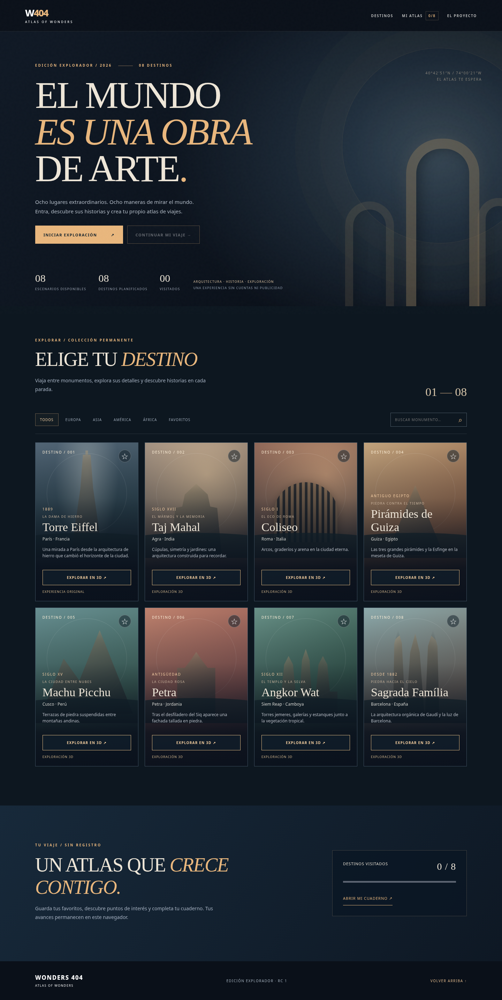

# WONDERS 404 — Atlas of Wonders

**Edición Explorador / Definitive RC1 (2026-10-11)** · Una colección artística de ocho destinos en 3D, totalmente local-first y compatible con GitHub Pages.

> **Estado:** versión candidata para pruebas. No es un simulador fotorrealista ni una digitalización arqueológica. La experiencia 3D real sigue requiriendo validación visual y de rendimiento en navegadores con WebGL habilitado.

## Los ocho destinos

- Torre Eiffel, París — visor original EIFFEL 404, copiado de forma aislada en `legacy/eiffel/`.
- Taj Mahal (Agra), Coliseo (Roma), Pirámides de Guiza (Egipto), Machu Picchu (Perú), Petra (Jordania), Angkor Wat (Camboya) y Sagrada Família (Barcelona): siete modelos geométricos interactivos y originales.

Cada escenario nuevo incluye cámara libre, zoom, rotación automática, tres atmósferas, visita a cuatro puntos, guardado PNG, sonido ambiente opcional, narración del texto cuando el navegador la permite y opciones de calidad gráfica. Los modelos siguen siendo simplificados y estilizados.

## Arranque local

**Windows**: descomprime y ejecuta `INICIAR_WINDOWS.bat`.

**Linux Mint**: descomprime y ejecuta `bash INICIAR_LINUX.sh` (o `./INICIAR_LINUX.sh` si tiene permisos de ejecución).

Requiere Python 3 para el servidor local. Alternativa:

```bash
python3 server.py
```

La consola imprime una URL de la forma `http://127.0.0.1:PUERTO/index.html`. El servidor elige un puerto disponible automáticamente. Si el navegador no se abre, copia esa URL manualmente. Cierra con **Ctrl+C**.

**Importante:** no abras `index.html` mediante `file://`; los módulos ES y algunos navegadores requieren un servidor HTTP.

## Controles

**Atlas:** Explorar, filtrar por continente, buscar un monumento, marcar favorito (☆), abrir Mi atlas, continuar viaje, exportar JSON y borrar el progreso local. Pulsa `/` para enfocar la búsqueda desde el catálogo.

**Escenarios:** arrastra para orbitar; rueda/pellizca para zoom; cambia entre día, atardecer y noche; elige una parada, activa la visita guiada o el modo fotografía. Pulsa **P** para fotografía, **M** para ambiente y **Escape** para abandonar fotografía. La tecla → salta a otro punto histórico.

El audio **no se reproduce automáticamente**. Se genera con Web Audio directamente en el dispositivo, sin pistas de terceros ni conexión a servicios. La narración por voz utiliza el motor del navegador, y puede no estar disponible en todos los equipos.

**Calidad gráfica:** baja (DPR máximo 1), media (DPR 1,45), alta (DPR 2). Ajusta principalmente la resolución de renderizado; no es una implementación de PBR, ray tracing o sombras reales. Comienza por **baja** si hay lentitud.

## Privacidad y funcionamiento

- Sin cuentas, anuncios, CDNs, analítica, telemetría ni llamadas a APIs de usuario.
- Las visitas, descubrimientos y favoritos se guardan en `localStorage` del navegador. Si se bloquea, la sesión funciona sin persistencia.
- Los destinos se cargan bajo demanda en un `iframe` y se descargan al cerrar el visor para liberar recursos.
- La Torre Eiffel se conserva aislada sin alterar sus archivos originales. Las mejoras compartidas de los siete escenarios nuevos no se aplican al visor Eiffel por compatibilidad.
- Los datos históricos son resúmenes divulgativos, no fuentes patrimoniales oficiales.

## Organización

- `index.html`, `styles.css`, `app.js`: interfaz del atlas, catálogo, filtros, diario.
- `js/core/renderer.js`: WebGL propio, texturizado procedural ligero, bruma, interpolación atmosférica y calidad configurable.
- `js/core/experience.js`, `.css`, `ambient.js`: visita guiada, descubrimientos, audio y controles compartidos.
- `js/monuments/*.js`: geometría de los siete monumentos.
- `scenes/*`: fichas visuales y visitas históricas por destino.
- `legacy/eiffel/`: copia original aislada.
- `server.py`, `INICIAR_*`: ejecución local.
- `tests/`: tests estáticos y de navegación/controles.

## Calidad y pruebas

```bash
python3 -m pytest -q tests
python3 tests/browser_smoke.py
```

`browser_smoke.py` precisa Playwright y Chromium. Dada la política de red y WebGL del entorno donde se desarrolló esta edición, inyecta HTML y JS en una página local de pruebas; **los controles 3D se verifican con un renderizador simulado**. Consulta `QA.md` para conocer el alcance, las pruebas completadas y las pendientes.

## Publicación en GitHub Pages

El proyecto usa enlaces relativos y es apto para servir desde la raíz de un repositorio en Pages. **Aún no se ha subido automáticamente a GitHub.** Ver `GITHUB_SETUP.md` y `QA.md` antes de publicar. Está pendiente decidir la licencia del repositorio y revisar compatibilidad y rendimiento en hardware real.

## Derechos de autor

El código base de Eiffel y sus recursos se conservan como parte de una copia aportada por el mismo propietario del proyecto. No se incluyen recursos de terceros obtenidos por scraping. No se declara una licencia de código abierto para esta edición hasta que el propietario elija una.

## Vista previa del atlas



La captura corresponde a la **interfaz del catálogo renderizada en Chromium**, no a los escenarios 3D.
